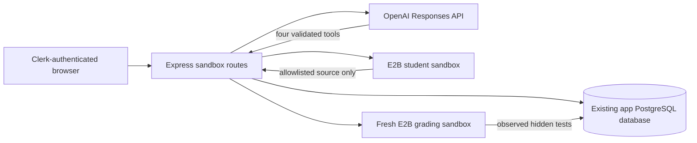

# AI Debugging Lab handoff

## S6 current repository audit — 2026-10-18

**Status: Gate A fails; implementation is paused before application-code changes.** This section describes the checked-in repository at `d788a331c7532554aceff30932d7a51789f2a398` and supersedes the historical status and verification claims below until their source artifacts are restored and rerun. The prior handoff is retained as historical context, not as evidence that the current branch builds or that its remote operations can be reproduced.

### Verified repository state

- The working branch is `feat/sandbox-hardening`, based on the current public `main` commit above. The prior `feat/product-ui-revamp` checkout was clean and remains unchanged.
- `apps/api/src/sandbox/service.ts`, `agent.ts`, migration `005_sandbox.sql`, sandbox tests, Code Lab UI/API/tests, spike scripts, and `sandbox-workflow.json` are tracked.
- The service imports `apps/api/src/sandbox/provider.ts` and `apps/api/src/sandbox/challenge/files.ts`; neither exists in this commit, any fetched branch history, the local dangling commit set, or the searched Desktop/Documents working-copy paths. Neither missing path has a Git ignore rule.
- `e2b` is imported by the live test and spike scripts but is absent from both API `package.json` and the root lockfile; it is also absent from the current `node_modules`. The described challenge lockfile, `apps/api/verification/e2b-spike-summary.json`, and `content/courses/` are absent from the tracked tree. `SANDBOX_HANDOFF.md` therefore overstates what a fresh clone contains.
- `architecture/05-api-contract.md` is v0.4 and contains no sandbox route or DTO definitions. Sandbox routes exist in `apps/api/src/app.ts`; future route/DTO changes must be reviewed against the wire-contract authority rather than inferred from the current implementation.

### Existing flow visible in checked-in code

Clerk middleware and `resolveUser` protect `/api/v1`; sandbox POSTs validate UUID request IDs and prompts with strict Zod schemas. `SandboxService` transactionally accepts a session or prompt and records the prompt count before calling the model. It then schedules E2B/model/test/finalization work with `setImmediate`, stores tool events and source snapshots, and on submission freezes a source snapshot before asking a fresh provider sandbox to grade it. The UI stores the session ID in `localStorage`, polls every three seconds, and fetches the final persisted report. Provider setup, file/path enforcement, actual challenge content, test commands, and grader isolation cannot be verified because both imported provider/challenge modules are missing.

### Ranked findings

1. **P0 — fresh-clone build is broken.** Root typecheck and build fail on missing provider/challenge imports. The failures also leave an implicit-`any` error in the file presentation path. Root tests fail loading the missing challenge module and the unlisted `e2b` package.
2. **P1 — work is process-local.** Session creation, model turns, visible tests, and grading are scheduled with `setImmediate`; there is no database claim/lease or stale-worker fencing. `cleanup()` can mark old work interrupted after five minutes, but cannot resume it.
3. **P1 — source/test evidence can diverge.** A model write reaches the provider before `recordToolEvent` commits `current_source/current_sha256`. If the database write fails, the remote file can differ from PostgreSQL. Visible-run records take their hash from the database snapshot without first reading and hashing the actual sandbox file. The files endpoint reads remote source while presenting the database hash.
4. **P1 — untrusted history is promoted into system instructions.** `agent.ts` interpolates prior learner prompts and assistant responses into a system-role string. Tool/source output and learner-controlled text need separate, lower-trust context.
5. **P1 — refresh recovery loses request identity.** The UI keeps the in-flight POST request ID only in React state. A reload during an ambiguous response loses it, and the initial session refresh removes the saved session ID on any fetch error, including transient network failure.
6. **P1 — sandbox security evidence is not reproducible from this tree.** The live E2B test cannot load its SDK, and the production provider implementation is absent. No path, symlink, network-lockdown, resource-limit, or secret-boundary assertion can currently be rerun.
7. **P2 — handoff/contract drift.** The historical handoff says the branch was not remotely checked and reports challenge files, SDK lock data, lessons, and E2B artifacts not present at the inspected remote tip. Existing sandbox endpoints are undocumented in API contract v0.4.

### Test results observed during this audit

| Command | Result |
| --- | --- |
| `npm run typecheck` | Failed in API compilation: missing `provider.js` and `challenge/files.js` modules. |
| `npm run build` | Failed in the same API compilation step. |
| `npm test` | Failed loading `challenge/files.js` and package `e2b`; 8 API tests passed before the two affected test files failed. |
| `npm run test --workspace=@trajectoryos/web` | Passed, 30/30 tests. |
| `npm run typecheck --workspace=@trajectoryos/web` | Passed. |
| `npm run build --workspace=@trajectoryos/web` | Passed; Vite emitted its existing large-chunk warning. |

The database integration suite, `npm ci`, root smoke command, browser visual checks, and any live E2B/OpenAI run were not run. Gate A is not met, so the feature's existing browser and remote execution claims remain unverified. No database operation or production change was made.

### Required source decision before continuing

Local history, fetched branches, and searched working copies did not contain the missing provider or challenge sources. The safe next step is to restore the original reviewed `provider.ts`, `challenge/files.ts`, pinned challenge lockfile, and associated verification artifacts from their authoritative working copy. If those originals no longer exist, replacing them would create a newly reconstructed challenge/provider, and could change challenge v1's grading truth. That requires explicit owner approval and must be documented as a reconstruction; it cannot be presented as the implementation previously tested in the historical handoff. Migration `005_sandbox.sql` is treated as applied and will not be rewritten; lifecycle changes would need an additive migration.

### External SDK documentation checked

The current official E2B SDK source documents `Sandbox.updateNetwork()` and network updates that replace the existing policy; it also documents `allowInternetAccess: false` as equivalent to `denyOut: ['0.0.0.0/0']`. The checked-in tree has no installed E2B package/types, so this is documentation/source review only—not verification against the app's installed SDK or a live network probe. See the [E2B SDK sandbox API](https://github.com/e2b-dev/E2B/blob/main/packages/js-sdk/src/sandbox/index.ts) and [network API types](https://github.com/e2b-dev/E2B/blob/main/packages/js-sdk/src/sandbox/sandboxApi.ts).

## Status and branch

Feature branch: `feat/ai-debugging-lab`, based on the locally available integrated frontend commit `d44bc728`. The remote repository could not be authenticated from this environment, so its current tip was not verified. Work was done in an isolated clone at `/tmp/trajectoryos-ai-debugging`; the original checkout and its local-only files were left untouched. Nothing was pushed.

The feature is **disabled by default**. Migration `005_sandbox.sql` was applied to the configured development PostgreSQL database for verification. Public deployment remains a separate release decision.

## Architecture and trust boundaries

The learner sees a read-only code viewer and directs source edits through the model. The model can list and read six reviewed files, replace only `src/rateLimiter.ts`, and invoke one fixed visible-test command. It has no shell tool and never receives hidden tests. Every model argument is validated again on the API server; E2B paths are checked for allowlist membership and symlinks. The E2B instance receives no database, Clerk, or OpenAI credentials.

The provider creates each sandbox, writes the reviewed challenge and pinned lockfile, runs `npm ci`, then invokes E2B `updateNetwork({ allowInternetAccess: false })` before the learner can use it. The fresh grader writes the submitted allowlisted source and private tests only after the submission is frozen. Both student and grading sandboxes are killed after use; the student sandbox also has a provider-side TTL. The API cleanup pass expires abandoned sessions and marks stale work as interrupted.

The synthetic challenge contract is fixed-window, epoch-aligned admission per API key. The starter has a shared bucket, an exact-boundary fault, a first-request-aligned reset, and incorrect Retry-After behavior. Visible tests cover boundary, scope and delay; hidden tests also cover a non-aligned start, denial capacity and cross-window independence. This is an assessment of those behaviors only.

## Persistence and retry policy

Migration `apps/api/migrations/005_sandbox.sql` adds `app.sandbox_sessions`, `app.sandbox_turns`, and `app.sandbox_test_runs`. Existing credit evidence and evaluator tables are unchanged. Session states are `creating → ready → processing → freezing → grading → submitted`, plus `expired` and `error`. A partial unique index allows one active session per user. A global advisory transaction lock bounds active sessions by `SANDBOX_MAX_ACTIVE`.

Every side-effecting POST requires a UUID `clientRequestId`. Repeating the same session, turn, or visible-test request returns the original record. Reusing a turn request ID with a different prompt returns 409. Submission has exactly one request ID; another one returns 409. A turn is recorded and its prompt slot is incremented under a row lock *before* model execution. A model failure leaves that slot consumed and preserves completed tool events and source changes. After five accepted prompts, visible tests and submission remain available, subject to the ten-run visible-test cap.

Submission changes state to `freezing` under the session row lock. The worker reads and size-checks the actual allowed source, hashes and saves it, then grades in a new sandbox. A provider or test timeout is recorded separately from an incorrect result. The final report stores original and submitted source, hashes, transcript, tool events, visible and hidden observations, model identifier, grader sandbox identity, runner/SDK details and scope limits. A database trigger prevents later changes to the submitted source and completed report.

## API contract

All routes require the existing Clerk bearer token and return the API `data`/`meta` envelope. Other users' session IDs return 404.

| Method | Path | Request / result |
| --- | --- | --- |
| GET | `/api/v1/sandbox/availability` | `{ available, challengeSlug, challengeVersion }` |
| POST | `/api/v1/sandbox/sessions` | `{ "clientRequestId": "<uuid>" }` → 202 session |
| GET | `/api/v1/sandbox/sessions/:id` | Session, turns, visible runs, server-derived prompt count |
| GET | `/api/v1/sandbox/sessions/:id/files` | Actual current sandbox files while active; persisted snapshot after submission |
| POST | `/api/v1/sandbox/sessions/:id/turns` | `{ "clientRequestId": "<uuid>", "prompt": "..." }` → 202 turn |
| GET | `/api/v1/sandbox/sessions/:id/turns/:turnId` | Turn status, response and tool events |
| POST | `/api/v1/sandbox/sessions/:id/visible-tests` | `{ "clientRequestId": "<uuid>" }` → 202 run |
| POST | `/api/v1/sandbox/sessions/:id/submit` | `{ "clientRequestId": "<uuid>" }` → 202 frozen/grading session |
| GET | `/api/v1/sandbox/sessions/:id/report` | Persisted report after submission; 409 while pending |

Long E2B and model operations return 202 and are polled through GET. No request body accepts a shell command or arbitrary file path.

## Configuration and packaging

Set these only on the API host: `E2B_API_KEY`, `OPENAI_API_KEY`, `DATABASE_URL`. Set `SANDBOX_ENABLED=true` only after reviewing provider access and deployment controls. `SANDBOX_AGENT_MODEL` defaults to unset and must be set explicitly when enabling the lab; the verified model was `gpt-6-luna`. `SANDBOX_MAX_ACTIVE` defaults to 4 and `SANDBOX_SESSION_TTL_SECONDS` to 1200. The web app uses its existing Clerk and API origin configuration; it has no provider keys.

Build from the monorepo root so the package script copies the reviewed sandbox lockfile into `apps/api/dist/sandbox/challenge/`. Run migration `005_sandbox.sql` through the existing migration command before starting the new API. The challenge package uses exact `tsx@4.20.0` plus a committed transitive lockfile. E2B's base sandbox was observed running Node `v20.9.0`; it could not use Node's TypeScript stripping flag. The host SDKs resolved to `e2b@2.56.0` and `openai@7.36.0`.

## Verification observations

| Check | Actual observation |
| --- | --- |
| E2B SDK proof | Starter 0/3 visible, repaired 3/3; file read/write matched; sandbox killed and `isRunning()` false. See `apps/api/verification/e2b-spike-summary.json`. |
| Production provider | Starter 0/3 visible and 0/4 hidden; repaired 3/3 visible and 4/4 hidden in fresh sandboxes. |
| Real model tools | `gpt-6-luna` requested list/read/write/test tools, changed source, passed 3/3 visible and 4/4 hidden. One observed call used 6,766 input and 781 output tokens. |
| File security | Traversal read/write and symlink read/write were rejected in a real E2B sandbox. |
| Network | HTTPS to npm registry succeeded before E2B network lockdown and timed out with curl exit 28 after lockdown. This checks that destination and setup, not every possible egress path. |
| Complete live workflow | A database-backed session accepted one prompt; `gpt-6-luna` requested list/read/write/test, changed source, passed 3/3 visible tests, and persisted a `correct` report after 4/4 hidden tests in a fresh E2B grader. See `apps/api/verification/sandbox-workflow.json`. |
| Database | Migration 005 applied; sandbox integration test passed concurrent acceptance, same-key idempotency, five prompts, owner isolation, visible-test timeout, expiration, provider failure and persisted report. Existing B2 and B3 integration tests passed sequentially. |
| Build and unit tests | API and web typecheck/build passed; root `npm test` passed 11 API and 26 web tests. |

The real model spike took a bounded tool sequence. The E2B proof observed sandbox creation in about 1.5 seconds, pinned runner installation in about 3 seconds, and individual test commands around 1 second after setup. The first model spike consumed 6,766 input and 781 output tokens; using the [published GPT-6 Luna token rates](https://developers.openai.com/api/docs/models/gpt-6-luna), that is approximately USD 0.0011 before any cache, regional or billing adjustments. E2B billed cost was not available from the SDK probe. The model/tool loop follows the [OpenAI function-calling guide](https://developers.openai.com/api/docs/guides/function-calling), and sandbox creation/network methods follow the [E2B SDK reference](https://e2b.dev/docs/sdk-reference/js-sdk/v2.6.2/sandbox) plus the installed `e2b@2.56.0` type declarations.

## Limitations and integration work

- The route is wired into the existing Engineering Lab at `/lab/ai-debugging`; browser sign-in and responsive visual layout have not yet been observed in a real browser session.
- The browser viewer is read-only; edits happen only through validated model tools. The diff is a simple changed-region display rather than a full line diff engine.
- The challenge's in-memory limiter is a one-process exercise. It does not assess multi-replica rate limiting, deployment behavior, authorship or general skill.
- The private tests are absent from the learner sandbox. Submitted code runs in the grading sandbox alongside tests, so this is an execution boundary and delayed disclosure, not a defense against arbitrary adversarial source introspection inside the grader.
- Model/provider turn failures consume a prompt and retain applied edits. The UI shows that failure; a learner may continue with remaining prompts.
- The local remote Git tip could not be checked because Git authentication failed. Rebase or merge against the latest integrated branch before sharing, without overwriting Rachit's work.
- Earlier broad and live verification attempts encountered intermittent host database/network failures. The final complete live workflow and sequential database integration rerun passed.

## Learning content

`content/courses/` contains 18 original draft lessons across Computer Networks, Database Internals, OOP, LLD, HLD/System Design and DSA. Each lesson has an authoritative source, example or diagram, concept check, challenge mapping and open question. The [source manifest](content/courses/README.md) lists verified publisher links. These are editorial drafts, not a complete course or a modification to the published retry-safe-credit v1 content. Team Google Docs and ChaiCode notes were unavailable and were not claimed as sources.

## Commits

- `bf1db61` — sandbox: verify E2B execution and add provider spike
- `0f48283` — content: add sourced engineering lesson drafts
- Backend, frontend and verification commits follow; see `git log --oneline` on this branch for final SHAs.
